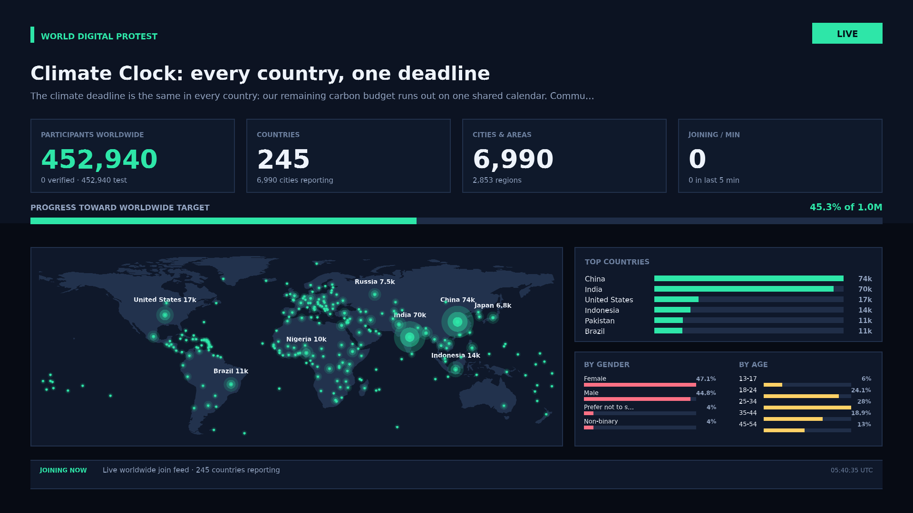

# Streaming a protest to YouTube live

A protest can be on air in two ways, and they are not alternatives — most operators use both:

| Path | What it does | Who it is for |
| --- | --- | --- |
| **Direct push (server → YouTube)** | The server draws the KPI frame itself and publishes it to YouTube over RTMP as a real live video. | Default. No OBS, no browser tab, no screen capture, no operator. |
| **Overlay (browser → OBS)** | A transparent web page you add as a Browser source in OBS, on top of your own camera or footage. | When you want a human host, a camera, or produced video. |

This document covers both. The direct push is the part that makes the platform self-contained: once
it is started, the stream survives the operator closing their laptop, and the join counter updates
on air by itself.

---

## 1. Direct push: the server streams to YouTube itself



### 1.1 Create the live stream on YouTube first

1. Open **YouTube Studio → Create → Go live → Stream**.
2. Give the event the protest headline, set the thumbnail, choose *Public* (or *Unlisted*).
3. Copy the **Stream key**. Do not copy the stream URL — this app knows YouTube's ingest endpoints.

YouTube rejects a publish to a key that has no event behind it, so always create the event first.

### 1.2 Attach the key to a protest

Open the protest page and use the **Push this protest straight to YouTube Live** panel:

1. Paste the stream key.
2. Choose frame rate and bitrate (defaults: 1 fps, 2.5 Mbps, RTMPS).
3. **Save settings**, then **Go live**.

The same thing over the API:

```bash
# store the key (server-side only) and pick the transport
curl -X PUT http://localhost:3000/api/protests/climate-clock/broadcast \
  -H 'content-type: application/json' \
  -d '{"streamKey":"abcd-1234-wxyz-9876","fps":1,"bitrateKbps":2500,"transport":"rtmps"}'

# go live
curl -X POST http://localhost:3000/api/protests/climate-clock/broadcast/start \
  -H 'content-type: application/json' -d '{}'

# health, uptime, frames, bytes, reconnect count, masked destination
curl http://localhost:3000/api/protests/climate-clock/broadcast

# stop
curl -X POST http://localhost:3000/api/protests/climate-clock/broadcast/stop
```

The protest page also shows a live preview of the **exact** frame being pushed
(`/api/protests/:id/broadcast/frame.png`), refreshed every 15 seconds.

Once the stream is live, attach the video id back to the protest so every page embeds the player:

```bash
curl -X PATCH http://localhost:3000/api/protests/climate-clock \
  -H 'content-type: application/json' \
  -d '{"youtube": {"videoId": "2Mp0L4pUpzE", "live": true}}'
```

### 1.3 Why the key never reaches a browser

A YouTube stream key is a password: anyone holding it can publish to your channel. So:

- it is accepted by `PUT /api/protests/:id/broadcast` and written to
  `$WDP_DATA_DIR/broadcast-keys.json` with mode `0600`, outside the protest record;
- every read returns `hasKey` plus a masked hint (`abcd••••••••9876`), never the key;
- the ffmpeg command line is rewritten (`<stream-key>`) before it is logged or returned;
- the key is never put in the exported data, the SSE stream, the overlay, or the page source.

Back that file up like a credential, and delete the entry (`{"streamKey": ""}`) when a protest ends.

### 1.4 What the frame contains

Exactly the KPIs the platform is allowed to show — nothing else:

- protest headline, reason, and a LIVE / opens-soon / finished badge
- participants worldwide, split verified vs injected test
- countries reporting, cities/areas, joining per minute
- progress toward the worldwide target
- world map with a bubble per country, sized by joiners
- top six countries, gender and age breakdowns
- a live arrival ticker of generated protester names with city and country
- the UTC clock

No personal data exists to leak: names are generated per protest, and coordinates are never stored.

### 1.5 How the pipeline works

```
renderer (pureimage, 1920x1080)  →  raw RGBA frames  →  ffmpeg  →  rtmp(s)://a.rtmp.youtube.com/live2/<key>
       1 frame per second, server-side                                     libx264 + AAC silence
```

- **Static layer caching.** Background, panels, headings, country labels and coastlines are rendered
  once and reused. A warm frame costs ~80–170 ms; without the cache it is ~650 ms. That is what
  makes a steady 1 fps affordable in one Node process.
- **Raw pixels, not images.** Frames go into ffmpeg as RGBA, so no JavaScript codec sits in the hot
  path. ffmpeg does H.264 once, properly.
- **An audio track always exists.** YouTube refuses or flags video-only streams, so ffmpeg mixes in
  generated silence.
- **Backpressure is respected.** If a frame cannot drain, the loop waits instead of buffering frames
  in memory, so a slow link lowers the frame rate rather than growing RAM.
- **Reconnects back off.** 2 s, 4 s, 8 s … capped at 60 s, indefinitely.
- **Shutdown is clean.** `SIGTERM`/`SIGINT` closes stdin so ffmpeg can end the RTMP session; YouTube
  sees a finished stream rather than a drop.

### 1.6 Cost and capacity

At 1 fps with `-tune stillimage`, a 1080p dashboard frame encodes to roughly 0.15–0.35 MB/s at
2.5 Mbps — a few hundred MB per hour of uptime. Rendering is the CPU cost, not encoding:

| Setting | Approx CPU per stream | Use when |
| --- | --- | --- |
| 0.5 fps, 1.5 Mbps | ~0.15 core | Many protests in parallel |
| 1 fps, 2.5 Mbps | ~0.25 core | Default |
| 2 fps, 4 Mbps | ~0.45 core | The clock/ticker motion matters |

YouTube allows one active stream per key. Use one key per protest; the platform keeps a separate
`Broadcast` per protest and will not start a second one for the same id.

### 1.7 Configuration

| Variable | Default | Meaning |
| --- | --- | --- |
| `WDP_BROADCAST` | `1` | Set to `0` to remove the broadcast routes entirely |
| `WDP_BROADCAST_AUTORESUME` | `0` | Restart protests marked `autoStart` when the server boots |
| `WDP_RTMP_TARGET` | — | Custom ingest URL for all protests (self-hosted RTMP, another platform) |
| `WDP_FFMPEG` | bundled | Path to an ffmpeg binary, overriding `@ffmpeg-installer/ffmpeg` |
| `WDP_FONT_REGULAR` / `_BOLD` | auto-detected | TTF used to render the frame |
| `WDP_FRAME_DIR` | `var/frames` | Where preview frames are written |

**Fonts matter.** The renderer needs a real TTF; it searches the usual DejaVu, macOS and Windows
paths. On a bare server install DejaVu explicitly (`fonts-dejavu-core` on Debian/Ubuntu,
`font-dejavu` on Alpine — the bundled `Dockerfile` already does). If no font is found,
`/api/broadcast` reports `fonts.ready: false` and starting a broadcast fails with a clear message
instead of broadcasting an empty frame.

### 1.8 Verify without a YouTube account

```bash
npm run broadcast:check
```

This starts ffmpeg in RTMP **listener** mode as a stand-in ingest (real protocol, real handshake),
points a real `Broadcast` at it, waits for video to arrive, then decodes what was received and
asserts H.264 video and an AAC audio track. Nothing leaves the machine.

```bash
npm run frame -- climate-clock --out /tmp/frame.png   # render one frame, check fonts and layout
```

### 1.9 Other destinations

Any RTMP/RTMPS endpoint works. Set a custom target instead of YouTube's:

```bash
curl -X PUT http://localhost:3000/api/protests/climate-clock/broadcast \
  -H 'content-type: application/json' \
  -d '{"streamKey":"my-key","ingest":"rtmp://media.example.org/live/<key>"}'
```

`<key>` is replaced with the stored key. This covers self-hosted `nginx-rtmp`, SRS, MediaMTX, and
other consumer platforms.

---

## 2. Overlay: browser source in OBS

Use this when a human host or camera should be on screen with the numbers.

1. Add a **Browser** source.
2. URL: `https://<your-host>/overlay.html?id=climate-clock`
3. Width `1920`, height `1080` (the layout is fluid and scales to any canvas).
4. Enable **transparent background**.
5. Refresh the browser source when the protest starts; it reconnects on its own afterwards.

Useful toggles inside the overlay (bottom-right, hidden from capture once toggled):

| Control | Effect |
| --- | --- |
| `toggle background` | Adds a solid background, useful for previewing outside OBS |
| `hide links` | Hides the small control links so they are never captured |

Appending `#solid` to the URL starts with the background on.

Every number is pushed over Server-Sent Events the moment a join lands, from any country and over
any channel (internet, hotspot, Bluetooth, scanned code, or a synced offline queue).

---

## 3. Phone-friendly live dashboard

`/protest.html?id=...` is responsive: the same page works as a presenter screen, a phone view for
participants, and an embed inside another site (framing is explicitly allowed).

## 4. Number discipline

Injected test participants are counted separately in every payload (`real` vs `injected`), are
labelled in the ticker, and are labelled on the pushed frame. Before a real protest opens, clear
them — otherwise the stream itself will show test numbers on air:

```bash
curl -X POST http://localhost:3000/api/test/inject/climate-clock/clear
```

## 5. API summary

| Method | Path | Purpose |
| --- | --- | --- |
| `GET` | `/api/broadcast` | Encoder/font health and every active broadcast |
| `GET` | `/api/protests/:id/broadcast` | Status: state, uptime, frames, bytes, reconnects, masked target |
| `PUT` | `/api/protests/:id/broadcast` | Set the stream key and settings (fps, bitrate, transport, ingest, autoStart) |
| `POST` | `/api/protests/:id/broadcast/start` | Create the broadcast and connect |
| `POST` | `/api/protests/:id/broadcast/stop` | Stop and close the RTMP session cleanly |
| `POST` | `/api/protests/:id/broadcast/restart` | Apply new settings to a running stream |
| `GET` | `/api/protests/:id/broadcast/frame.png` | The exact 1920x1080 frame that would be pushed |
